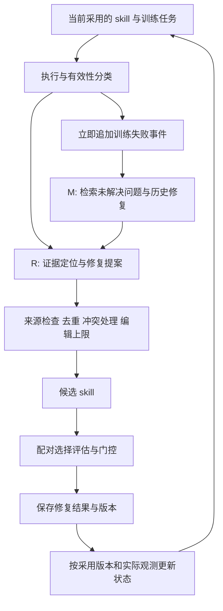

# R/M 方法与数据契约（待实现）

## 1. 主数据流

无 patch、JSON 错误、候选拒绝、结果不确定等分支都发生在失败事件持久化之后。基础设施异常进入独立事件流，不自动认定为 skill 缺陷。

## 2. R：证据驱动受控修复

每条 proposal 的最低契约：`proposal_id`、`skill_before_hash`、`failure_case_ids`、`evidence_refs`、`diagnosis`、`target_rule_id`、`repair_operator`、`patch`、`expected_observation`、`preserve_cases`。

- `evidence_refs` 是 task/run/trajectory step/artifact 的引用，不能只写模型的概括；引用必须属于本轮或合法历史训练数据。
- `diagnosis` 区分 missing_rule、wrong_rule、scope_error、execution_lapse、missing_check、unknown。执行失误不自动等于缺规则。
- 规则 ID 由代码维护的 sidecar 映射到精确文本锚点和版本哈希，不要求把整份 skill 改造成复杂可执行 DSL。
- `expected_observation` 描述可观察行为，例如“转换整列之前执行类型检查”，不是“更认真”。
- `preserve_cases` 引用相关训练成功案例；不足时显式为空，不能伪造成功反例，也不能把验证答案补进来。

建议修复操作：ADD_RULE、CORRECT_RULE、ADD_SCOPE、MAKE_ACTION_EXPLICIT、ADD_CHECK、REMOVE_CONFLICT。允许明确 `no_change`，并返回原因；证据不足则维持待诊断。

示例：轨迹只预览前五行就断言整列是数值。修复的触发条件为“操作依赖整列类型”；动作是“对实际数据区做类型检查”；后验检查是“识别并处理混合类型”。不要生成“全面理解数据”这种无法定位的要求。示例是合成说明，不是已发现的 benchmark 结果。

### 约束与预算

先检查 schema、真实任务 ID、证据路径、旧版本哈希、规则锚点和允许操作；之后合并同义/完全相同候选，精确相同目标上的冲突方案分开候选，不能同时应用。初版候选上限 4、实际应用上限 2，允许 0/1 条，不强制凑数。

跨不同训练任务的支持优先于重复采样次数；同一道题重复十次不能算十个独立支持。单例但可直接核验的缺陷可以受控尝试，不设“两个支持任务以下必须丢弃错误”的规则。支持数量不能替代证据质量。

预算不使用当轮最终测试结果，也不按“失败集中所以多写规则”扩张。程序验证结构一致性；诊断语义与实际收益仍由轨迹检查和执行评估验证。

## 3. M：一个模块，两类记录

### FailureCase / FailureEvent

建议字段：`case_id`、`task_id`、`source_split=train`、`skill_hash`、`run_id`、`event_id`、`trajectory_ref`、`failure_kind`、`first_seen_step`、`last_seen_step`、`seen_count`、`status`、`attempt_ids`。

保留不可变事件日志，再构造按 task+failure_signature+版本可查询的状态视图。故障 signature 是待验证归纳，不能错误地把一个任务的多个问题永久合并。相同 event_id 重试落盘应幂等。

状态：unresolved、resolved_observed、reopened、deferred。`resolved_observed` 必须有当前采用版本的实际成功执行证据，只表示观测修复，不表示永不复发。deferred/冷却不等于删除。

### RepairAttempt

建议字段：`attempt_id`、`case_ids`、`proposal_ids`、`skill_before_hash`、`skill_candidate_hash`、`operators`、`train_observations`、`selection_summary`、`gate_action`、`adopted`、`step`。

验证逐题结果保存在评估工件中。供优化器读取的记忆只允许训练轨迹与许可的聚合选择反馈，不能注入验证任务文本、答案或逐题验证 ID 作为训练支持。

一批编辑共享一次评估时，效应归属 update_bundle；没有独立隔离实验不能拆成单条编辑的因果分数。

### 状态处理示例

| 情况 | 错题状态 | 修复历史 |
|---|---|---|
| 训练失败，分析器无有效补丁 | unresolved | 记录 no_proposal 或生成失败类型 |
| 候选后仍然失败 | unresolved | 记录已尝试和观测结果 |
| 总体提升但该题仍错 | unresolved | 总体结果不覆盖逐题状态 |
| 候选中修好但候选未采用 | 当前采用版本仍 unresolved | candidate_resolved 单独记录 |
| 采用版本在训练重现时通过 | resolved_observed | 关联实际成功事件 |
| 后续采用版本又失败 | reopened | 保留过去修复链 |

### 检索和上下文

记录全部有效失败，但每次只提供有界上下文。第一版 top-k=3 问题组，每组最多 2 条修复历史，固定字符上限并记录 token 估计。优先相同任务/规则/失败类型，结合重复出现与尝试多样性；不以绝对分数变化为唯一权重。只读严格早于当前提案的事件。没有有用记录时返回空，不填充无关内容。

对历史结果的解释原则：规则没有执行→检查显著性/触发；执行后仍失败→检查诊断或其他缺陷；修复伴随退化→检查适用条件。以上是下一步诊断方向，不是自动证明原因。

## 4. 模块开关

| R | M | 修复提案 | 历史上下文 |
|---|---|---|---|
| 0 | 0 | 上游有界自由编辑 | 无持久问题/修复历史 |
| 1 | 0 | 证据驱动受控修复 | 仅当前 minibatch |
| 0 | 1 | 上游有界自由编辑 | 未解决问题和历史尝试 |
| 1 | 1 | 证据驱动受控修复 | 未解决问题和历史尝试 |

四组均保留离线审计日志，但 M=0 的日志禁止进入后续模型输入。R=0 仍有语法合法性和统一最大编辑数等基础约束，不等于允许任意破坏。R 含修复范式与编辑约束，因此本轮不能拆开声称 A、D 各自的独立贡献。
